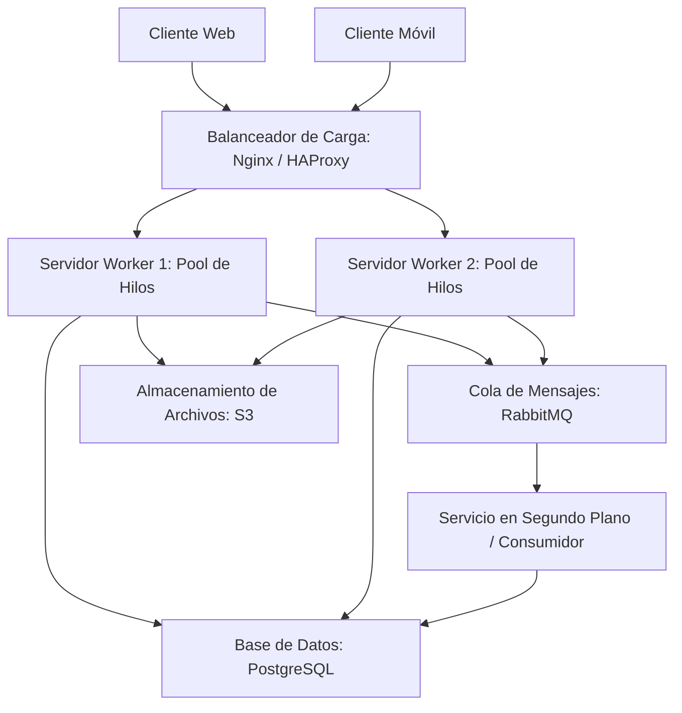

# PFO 3: Rediseño como Sistema Distribuido (Cliente-Servidor)

Este proyecto implementa la transformación de un sistema centralizado hacia una **arquitectura distribuida utilizando sockets TCP**. El trabajo se divide en el diseño teórico de una infraestructura de alta disponibilidad y la implementación práctica de un modelo concurrente en Python.

---

## 🏗️ 1. Diseño de la Arquitectura Distribuida

El siguiente diagrama ilustra la arquitectura propuesta para manejar múltiples peticiones concurrentes y escalar el sistema de manera horizontal. *(Nota: GitHub renderiza automáticamente este diagrama).*



### Componentes del Sistema:
* **Clientes (móviles, web):** Interfaces de usuario que inician las peticiones enviando las tareas hacia el sistema.
* **Balanceador de carga (Nginx/HAProxy):** Punto de entrada único que distribuye el tráfico de red entrante de manera equitativa entre los distintos servidores para evitar la sobrecarga de un solo nodo.
* **Servidores workers:** Nodos de procesamiento, cada uno equipado con su propio pool de hilos (Thread Pool), permitiendo manejar múltiples conexiones simultáneas sin bloquear el servidor principal.
* **Cola de mensajes (RabbitMQ):** Sistema de comunicación asíncrona entre servidores. Se utiliza para encolar tareas pesadas para que sean procesadas en segundo plano.
* **Almacenamiento distribuido:** Uso combinado de **PostgreSQL** para datos estructurados y relacionales, y buckets de **S3** (Simple Storage Service) para el almacenamiento de archivos estáticos y binarios.

---

## 💻 2. Implementación en Python

La prueba de concepto práctica se desarrolló en Python utilizando la librería nativa `socket` y `concurrent.futures`.

* **Servidor (`servidor.py`):** Un servidor TCP que escucha conexiones entrantes, recibe las tareas por socket y las distribuye dinámicamente a distintos workers disponibles.
* **Cliente (`cliente.py`):** Un script interactivo de consola que se conecta al socket del servidor, envía la descripción de las tareas ingresadas por el usuario y recibe los resultados procesados.

---

## 🛠️ 3. Instrucciones de Ejecución y Prueba

Para probar el sistema concurrente localmente, se requiere abrir múltiples terminales:

### Paso 1: Iniciar el servidor principal
Abrir una terminal en el directorio del proyecto y ejecutar:
```bash
python servidor.py
```
*El servidor quedará escuchando en `127.0.0.1:65432` con un pool de 5 workers listos para procesar tareas.*

### Paso 2: Iniciar los clientes (Simulación de concurrencia)
Abrir dos o más terminales adicionales y ejecutar en cada una:
```bash
python cliente.py
```
*Al enviar tareas desde los distintos clientes en simultáneo, el servidor principal delegará cada conexión a un worker diferente, demostrando el procesamiento paralelo sin bloqueos de red.*

---

## 📸 4. Evidencia de Pruebas Concurrentes

*(Capturas de consola demostrando la conexión simultánea de múltiples clientes y la delegación exitosa a los workers del servidor).*

### Consola del Servidor


### Clientes Concurrentes


